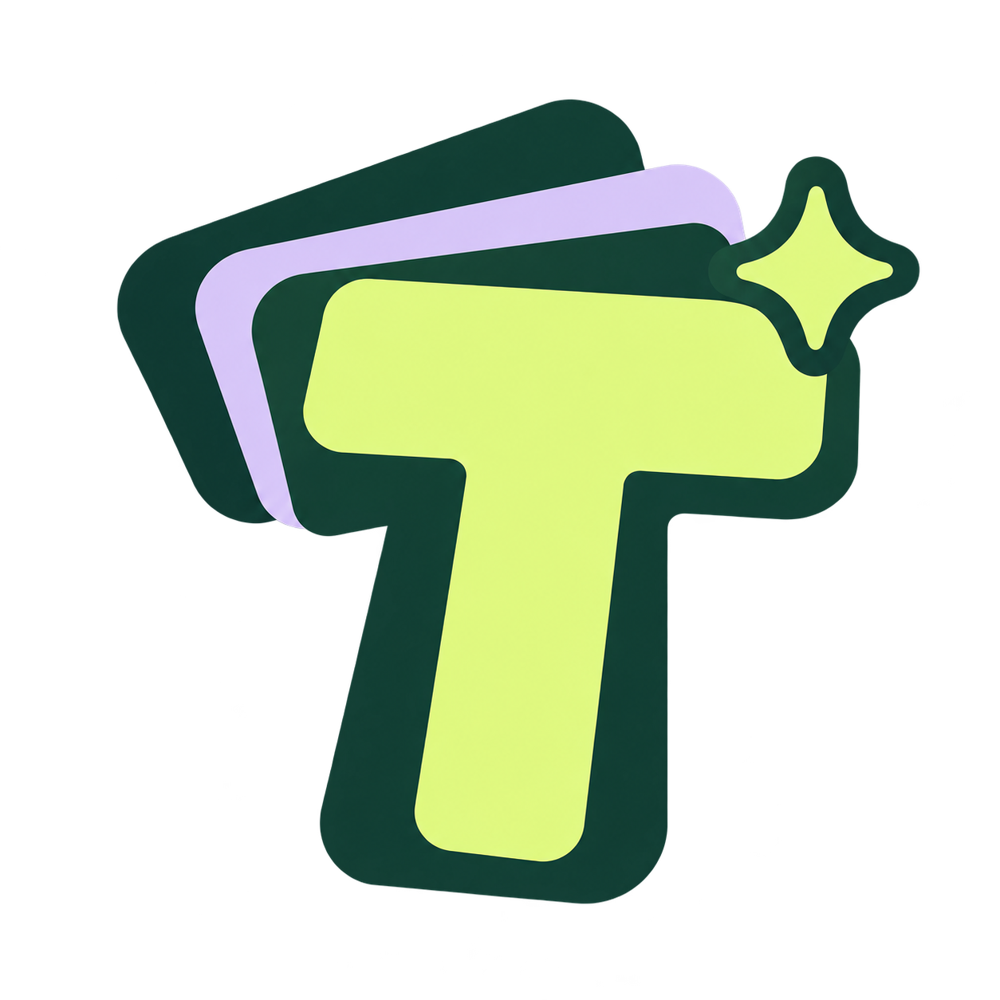
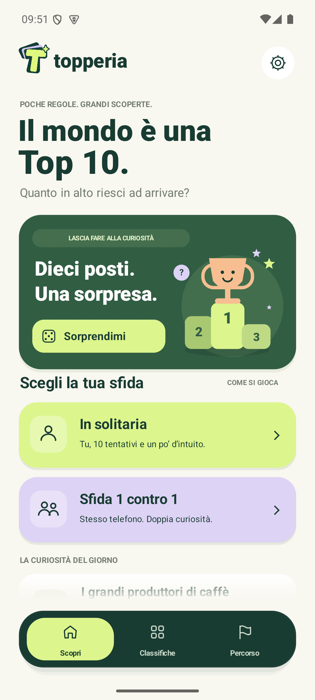

  

<h1 align="center">Topperia</h1>

<strong>Il mondo è una Top 10. Quanto in alto riesci ad arrivare?</strong>

  
  
  
  

  <a href="https://github.com/carellice/Topperia/releases/latest"><strong>Scarica Topperia per Android</strong></a>
  &nbsp;·&nbsp; <a href="#come-si-gioca">Come si gioca</a>
  &nbsp;·&nbsp; <a href="docs/RELEASING.md">Pubblicare una versione</a>
  &nbsp;·&nbsp; <a href="docs/PRIVACY.md">Privacy</a>

Un trivia nativo Android, in italiano, per chi ama chiedersi «ma sarà davvero nella Top 10?». Trenta classifiche reali, dieci tentativi e il piacere di una risposta inaspettata. **Tutte le partite funzionano offline**, da soli o sfidandosi sullo stesso telefono.

  

## Come si gioca

1. **Scegli una curiosità.** Apri una classifica oppure lascia scegliere a **Sorprendimi**.
2. **Scrivi la tua idea.** Devi indovinare un elemento, senza indicarne la posizione. Il gioco gestisce accenti, maiuscole e alias riconosciuti.
3. **Scopri il suo posto.** Una risposta presente gira la casella e mostra nome, posizione e dato. Hai dieci tentativi: gli errori li consumano, le risposte vuote e quelle già provate sono gratuite.
4. **Guarda la classifica completa.** Alla fine si svelano tutte le posizioni. Ogni risposta trovata vale un punto: sei scoperte significano **6 su 10**.

| Modalità | La sfida |
| --- | --- |
| **In solitaria** | Tu, dieci tentativi e un po’ d’intuito. Una partita interrotta si riprende dalla home. |
| **1 contro 1 locale** | Due giocatori o squadre, una classifica e dieci tentativi ciascuno. Tabelloni indipendenti, passaggio del telefono con risposte nascoste e confronto finale. Vince chi ne trova di più; è possibile pareggiare. |

Record, statistiche, preferenze e piccoli traguardi restano sul dispositivo. Nessun account, pubblicità o acquisto in app.

## Piccole cose, curate

- **Sorprendimi:** una scelta casuale animata che rispetta categoria e modalità, dà precedenza alle classifiche non completate ed evita ripetizioni durante il ciclo.
- **Un benvenuto in tre scene:** spiega il gioco al primo avvio; puoi saltarlo e rivederlo dalle impostazioni.
- **Grafica originale:** logo creato con ImageGen, avorio, bosco e lime, carte che si girano, una barra flottante e coriandoli per le tue scoperte.
- **Movimenti curati:** passaggi tra pagine senza lampeggi, pannelli che scorrono e si chiudono anche trascinandoli, pulsanti e interruttori animati. Le classifiche scorrono con inerzia e disegnano soltanto le schede visibili.
- **Controlli Android:** tastiera nativa, suoni, feedback aptico, controlli per l’accessibilità e animazioni ridotte.

Il simbolo originale, il prompt e le informazioni sulla sua integrazione sono in [branding/](branding/README.md).

## Trenta modi di essere curiosi

**30 classifiche e 300 risposte**, dalle montagne alle lune del Sistema solare, dai nomi italiani agli aeroporti, dal consumo di birra ai film e ai videogiochi.

Ogni round dichiara **anno, criterio e fonte**. Il catalogo è incluso nell’app: contiene fotografie dei dati in un momento preciso e non interroga servizi esterni durante la partita. Le serie storiche mantengono il proprio riferimento temporale.

Le fonti si consultano dal gioco e nella documentazione:

- [Classifiche originali](data/SOURCES.md): Kirin, ONU, medagliere olimpico, grattacieli, montagne e lune.
- [Natura, spazio e scienza](data/SOURCES_NATURE.md): laghi, fiumi, parchi, costellazioni, elementi e altre curiosità.
- [Italia, mondo e cultura](data/SOURCES_WORLD.md): Istat, aeroporti, caffè, cinema, musica e videogiochi.

## Installa e resta aggiornato

Apri [l’ultima release](https://github.com/carellice/Topperia/releases/latest), scarica l’APK **Topperia-&lt;versione&gt;.apk** e aprilo sul dispositivo. Richiede **Android 8.0 o successivo**. Se richiesto, Android ti permette di autorizzare l’installazione dall’app con cui hai aperto il file.

Puoi cercare una nuova versione dalle **Impostazioni di Topperia**. L’app controlla anche le release stabili pubbliche su GitHub, al massimo una volta ogni 24 ore; se sei offline o hai già l’ultima versione non interrompe la partita.

Il download parte dopo la tua conferma. Topperia verifica versione, integrità e firma del pacchetto, quindi propone **Installa**. L’aggiornamento passa sempre dalla conferma dell’installer Android; se necessario, Android richiede prima il consenso per installare aggiornamenti da Topperia. I dettagli sulle richieste di rete e sui dati locali sono nella [privacy](docs/PRIVACY.md).

## Compila il progetto

Apri la cartella in **Android Studio** oppure usa il wrapper Gradle incluso. Servono **JDK 17 o successivo** e **Android SDK 36**; il sorgente Java usa il livello 17.

~~~powershell
git clone https://github.com/carellice/Topperia.git
cd Topperia
.\gradlew.bat :app:assembleDebug
~~~

L’APK di sviluppo si trova in `app/build/outputs/apk/debug/app-debug.apk`. Configura l’SDK da Android Studio o tramite il tuo `local.properties`, che resta locale. La prima compilazione può scaricare gli strumenti e le dipendenze dichiarati dal progetto.

Verifiche del motore, del catalogo, delle estrazioni casuali e delle regole degli aggiornamenti, senza avviare Android:

~~~powershell
.\scripts\test-engine.ps1
~~~

Controlli Android Lint:

~~~powershell
.\gradlew.bat :app:lintDebug
~~~

Il gioco è scritto in Java con interfaccia nativa e grafica `Canvas`, senza WebView. Le regole e i dataset sono separati dal rendering; l’aggiornamento dell’app è separato dal funzionamento offline delle partite.

## Pubblica la prossima versione

Dopo la configurazione iniziale descritta nella [guida alle release](docs/RELEASING.md), fai doppio clic su **[release.bat](release.bat)** dalla copia locale del repository, oppure esegui:

~~~powershell
.\release.bat
~~~

La procedura controlla autenticazione, firma e stato del repository; incrementa automaticamente **versione patch e codice versione**, esegue test e controlli, compila e verifica l’APK firmato. Crea il commit di versione e il tag, prepara una **bozza GitHub**, carica e verifica gli asset, quindi pubblica la release stabile.

La release contiene APK, metadati `update.json` e checksum SHA-256, usati dall’app per trovare e verificare gli aggiornamenti. Chiavi, password e credenziali restano sul computer dello sviluppatore.

~~~powershell
.\release.bat -DryRun   # Mostra il piano senza modifiche o pubblicazioni
.\release.bat -Resume   # Riprende una release interrotta senza un nuovo incremento
~~~

Prerequisiti, firma, note personalizzate e recupero degli errori sono documentati in [docs/RELEASING.md](docs/RELEASING.md).

---

Il [repository è pubblico](https://github.com/carellice/Topperia). Non è attualmente presente un file di licenza open source.
